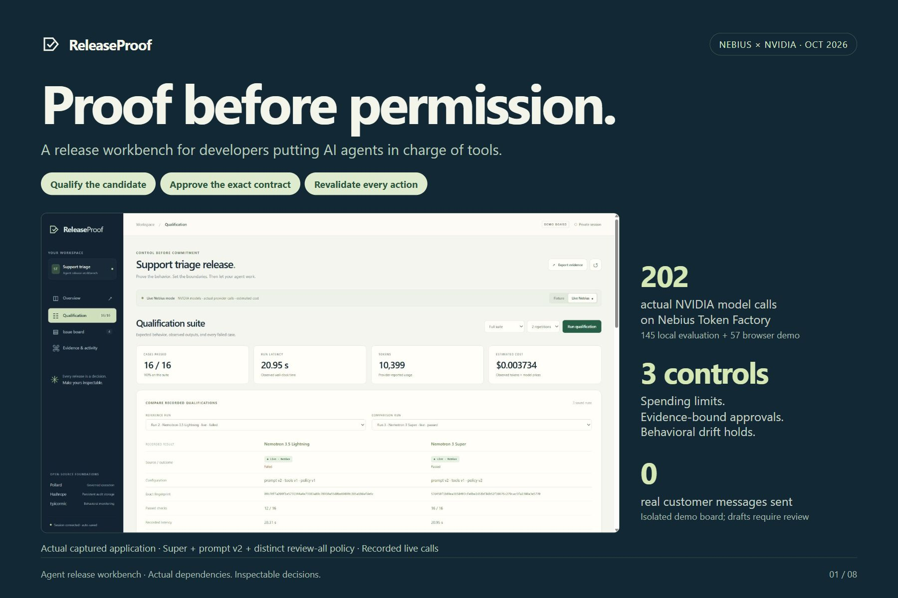

# ReleaseProof



[Devpost entry](https://devpost.com/software/releaseproof-yr8e0t) · [Architecture](artifacts/submission/02-architecture.jpg) · [Measured results](artifacts/submission/03-measured-results.jpg) · [Visual walkthrough](artifacts/submission/README.md)

**An agent release decision backed by the exact evidence that was tested.**

ReleaseProof is a small workbench for qualifying an issue-triage agent before promoting it. It binds the release decision to the model, prompt, tool contract, policy, and evidence; reserves inference budget before calls; and holds future actions when the release changes or a controlled drift probe fails.

The bundled workflow reads synthetic issues, chooses a label and route, and prepares a response draft. An approved agent can update an isolated local demo board. It never sends a response to a real issue tracker or person.

**Judge access:** public live inference is currently disabled following the confirmed October 30 submission. Use the [public fixture workbench](https://jemsbhai-releaseproof.hf.space), [recorded actual live calls and failures](https://jemsbhai-releaseproof.hf.space/assets/observations.html), and [2:24 demo video](https://youtu.be/1ZAR8XT7tiA). These require no account or API key; fixture results are not fresh model measurements. Local live reproduction remains documented below for an independently configured provider account and spending authority.

## Start locally

Requires Python 3.12. From the repository root:

```bash
python -m venv .venv
# Windows PowerShell
.venv\Scripts\Activate.ps1
# macOS/Linux: source .venv/bin/activate
python -m pip install -r requirements.txt
python -m uvicorn releaseproof.server:app --host 127.0.0.1 --port 7860
```

Open <http://127.0.0.1:7860>. The server serves the buildless web UI; no Node installation, model download, or GPU is needed. The main dependencies are Pollard 1.6.2, Epicormic 0.2.0, Hashrope 0.2.2, FastAPI, Uvicorn, and HTTPX. Pytest is used for development verification. The repository's dependency file is authoritative.

The default mode uses clearly labelled synthetic fixtures. **Fixture results are not measurements of Nemotron quality.** SQLite alone supports this fixture workflow. Every live run requires an NVIDIA model served through Nebius Token Factory and a configured, healthy Firestore spending authority.

## Enable Nebius inference

Use server environment variables, never client-side JavaScript or committed credentials:

```powershell
$env:NEBIUS_API_KEY = "<your private API key>"
$env:RELEASEPROOF_FIRESTORE_PROJECT = "<your Google Cloud project ID>"
$env:GOOGLE_SERVICE_ACCOUNT_JSON = Get-Content -Raw "<private service-account JSON path>"
$env:RELEASEPROOF_LIVE_ENABLED = "1"
$env:RELEASEPROOF_LIVE_LIMIT_USD = "5"
python -m uvicorn releaseproof.server:app --host 127.0.0.1 --port 7860
```

For a POSIX shell, use `export NAME=value`. The example file `.env.example` documents the supported settings; setting values there alone does not load them into the process. Keep keys in the host's secret store for a public deployment. `/api/health` reports whether live inference is available without exposing credentials.

Firestore is mandatory for live inference on both local and public hosts. Before enabling live mode, create the default Firestore database and initialize the shared budget once with [the operator script](scripts/initialize_cloud_ledger.py), using the intended allowance and carrying forward any prior spend or unresolved reservations. Give the server's service account access to that database. All instances must share the same authority; creating another ledger is not a budget reset. The runtime reads `RELEASEPROOF_FIRESTORE_PROJECT` and the private `GOOGLE_SERVICE_ACCOUNT_JSON` secret; it does not create or reset the budget. Missing configuration, credentials, initialization, or ledger availability blocks live dispatch. There is no SQLite live opt-in or fallback. Fixture workflows remain usable without Firestore.

The three candidate model IDs and input/output prices were checked against the authenticated Nebius account on October 30, 2026; see [the recorded pricing assumptions](docs/EVALUATION.md#verified-catalog-and-price-assumptions). Actual Lightning and Super calls and every failed qualification are preserved in [Evaluation](docs/EVALUATION.md#recorded-live-results--october-30-2026) and the [read-only recorded-evidence report](https://jemsbhai-releaseproof.hf.space/assets/observations.html). Recheck availability and prices before a live run. The UI displays its pricing assumptions, excluding applicable taxes. Spend shown from token usage is an estimate, not the provider's authoritative bill. Ollama or other providers are not substitutes for the hackathon's required Nebius runtime call.

## Try the workflow

1. Create a session and run the **Full suite** in **Synthetic fixture** mode, or **Live Nebius** when enabled. Inspect the case-level actual and expected results, including failures. The four-case quick suite is a smoke test only and cannot authorize promotion; all eight full-suite cases, including adversarial cases, must pass.
2. Promote a qualified configuration. Run the triage action and inspect the changed local board and saved draft.
3. Change the prompt, tool contract, or policy. Attempt promotion or execution: the prior qualification cannot authorize the changed release.
4. Requalify, then run the labelled **injected drift** experiment. Inspect the repeated probes and attempt another action. A hold applies to future actions. The optional live probe requires a passing live qualification with at least two fresh samples per issue; its small sample has low statistical power.
5. Try mitigation and a smaller budget. Inspect why the server accepted or refused a call, how much it reserved, and the protected recovery allowance.
6. Export the evidence packet to inspect the configuration, observations, source modes, and release decision.

The synthetic data contains eight qualification and four additional holdout cases. Their gold decisions, limitations, and review rules are documented in [Evaluation](docs/EVALUATION.md).

## Why the three libraries matter

| Library | Role in ReleaseProof | What it does not prove |
|---|---|---|
| Pollard | Bounded execution and policy gates; budget decisions are enforced before work | That an allowed model answer is correct |
| Hashrope | Exact, persistent content versions for the tested release contract | That the content is true |
| Epicormic | Repeated behavioral probes and drift evidence used to hold future actions | General model safety, patch correctness, or the cause of drift |

The server rechecks the current contract before a consequential board update. An old pass, a client-supplied score, or a changed fallback configuration is not sufficient authorization. See [Architecture](docs/ARCHITECTURE.md).

## Verify

```bash
python -m pip install pytest
python -m pytest -q
```

Tests use fixtures and do not spend Nebius credits. Live model evaluation is a separate, explicitly enabled action. The interface exposes `/api/health`, `/api/catalog`, isolated capability-based sessions, and a downloadable evidence packet; see [API contract](docs/CONTRACT.md).

Latest offline verification, October 30, 2026: **88 tests passed** at source commit `823e4a6`. This does not verify live model quality or provider availability.

## Scope and limitations

- The dataset is small, public, synthetic, and authored for this demo. Public holdouts are not an independent benchmark once inspected or used for tuning.
- The four bundled board cases have known gold decisions, which the server checks before applying a demo action. The application does not establish correctness on arbitrary real issues.
- Fixture, live, replay, and injected-fault sources must remain visibly distinct. A replay does not make fresh inference deterministic.
- Passing the included tasks is a narrow observation. Behavioral stability and correctness are different properties.
- A declared configuration mutation is not evidence of silent provider drift. Injected drift demonstrates the response mechanism, not an incident observed at Nebius.
- Holds and fallbacks affect future actions; they do not undo already completed actions. A fallback must satisfy the current approval contract.
- The application is a single-process demonstration with a local board, not a production issue tracker or a general deployment security service. Protect the session capability URL as access to that demo session.
- Storage is bounded to 250 sessions, 100 accepted actions per session, a 2 MiB session snapshot, and a 512 MiB SQLite database. Admission reserves conservative audit growth before work; large suites can be refused before dispatch. Evidence remains exportable after a quota refusal. Reset is explicit and does not renew the lifetime action allowance.
- Budget estimates depend on provider usage and pricing assumptions. The demo reserves worst-case call allowances, but the provider's billing remains authoritative.

## Hackathon submission

Target track: **Best Apps and Agents**. Required runtime: **NVIDIA Nemotron through Nebius Token Factory**. [Public workbench](https://jemsbhai-releaseproof.hf.space) · [Recorded live observations](https://jemsbhai-releaseproof.hf.space/assets/observations.html) · [Public demo video — 2:24](https://youtu.be/1ZAR8XT7tiA). The video uses genuine recorded application states with shortened pauses and disclosed synthesized narration. Live access is bounded by the shared allowance and provider availability; the labelled fixture workflow and recorded report remain useful without fresh inference. Export session evidence before leaving because the free host may reset session storage on restart.

Nebius schedules the tested Super serverless model's retirement for **November 9, 2026**, with no automatic rerouting. No replacement model has been evaluated here. Preserve fixture and recorded-evidence access through December 23; fresh Super access is not promised. [Official notice](https://docs.tokenfactory.nebius.com/model-deprecations-november-2026.md).

Pollard, Hashrope, and Epicormic are preexisting libraries. ReleaseProof's application, workload, qualification/promotion flow, interface, and documentation are new work; see [New-work disclosure](docs/NEW_WORK.md). Canopy informed the problem selection; no Canopy team-owned interface or benchmark is included.

Project source is licensed under [MIT](LICENSE). Dependencies retain their respective licenses; see [Dependency notices](THIRD_PARTY_NOTICES.md). The [Judge guide](docs/JUDGE_GUIDE.md) provides a short reproducible walkthrough.
