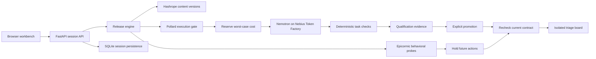

# Architecture

ReleaseProof asks a narrow question: can this exact issue-triage configuration take the next action under the current policy and budget? It combines measured task outcomes, immutable content identity, execution policy, and behavioral probes in one release decision.

## Release contract

The current model identifier, prompt version, tool version, policy version, and evidence identity form the release contract. Qualification evaluates that contract. Promotion is an explicit server action, and execution validates the current contract again. Changes invalidate old approval rather than silently reusing it.

Promotion requires the full eight-case qualification corpus. The quick four-case suite is a smoke test only. Request settings use JSON output with thinking disabled and a declared output-token cap; these settings are part of the configuration identity. Prompts and stored completion text are limited to 8 KiB each, and the provider response envelope to 64 KiB, so the API can reserve conservative audit-storage growth before dispatch.

The client may request an action and supply its supported parameters. It cannot supply authoritative pass verdicts, approval identities, fingerprints, balances, or metrics. The server serializes state changes per session. Private engine fields and credentials are excluded from public snapshots and evidence exports.

## Budgeted execution

Each provider attempt is admitted only after reserving its worst-case cost under the displayed input/output pricing and configured token bound. Observed token use reconciles the reservation. An uncertain dispatched request must be accounted for conservatively; a retry is new work, not a free invisible retry.

Normal work cannot consume the configured validation/recovery reserve. The workbench makes tradeoffs visible through its strategy, model, remaining allowance, reservation decisions, and blocked calls. The budget applies to qualification and monitoring overhead as well as useful workflow actions. It is a spending control under explicit price assumptions, not a promise to reproduce the provider's final invoice.

Session budgets and the operator's total hosting/inference authorization are separate limits. A new browser session must not reset the operator's allowance. Deployment operators must preserve the global spend ledger and the hosting provider's own limits across restarts.

An optional Firestore ledger provides the durable spending authority for hosts with ephemeral session storage. It stores budget counters and opaque reservation identities, not issue content or provider keys. The runtime requires an existing budget document; missing credentials, initialization, or ledger availability disables live dispatch without replacing it with a new local allowance. Fixture workflows remain available. Remote health checks are cached for 15 seconds; every live reservation still goes through the authority.

## Drift and mitigation

The included stable and injected-drift canaries are controlled local experiments with labelled provenance. They exercise repeated behavioral probes and demonstrate the hold path. An observed difference is not proof of a silent model change or a diagnosis of its cause.

The optional live probe compares fresh Nebius calls against two or three original successful live observations per issue, under the same contract. The analysis imports those recorded observations into Epicormic without generating another provider request; each record retains its original observation reference. Comparison covers label, route, and review flag, excluding draft wording. The sample is intentionally small and has low statistical power. A failed/incomplete current observation can hold the release even when a statistical test cannot establish a change.

Mitigation can hold future work, restore a previously approved configuration, or require requalification. Restoring a fallback configuration always requires fresh qualification and explicit approval; it does not prove that a hosted model reverted. None restores an approval for a changed contract or reverses a completed board action. A fallback whose old evidence no longer matches the server contract is refused.

## Data and external effects

`data/issues.json` contains synthetic issue text and expected label/route/review fields. The model produces a classification and draft. Board mutations are local application state; no GitHub comment, email, or other external message is sent.

Persist only the compact application state, traces, and version evidence needed for the demonstration. Model inference stays remote. This keeps the project compatible with the user's 4GB total storage cap without local model weights or GPU runtimes.

SQLite enforces 250 sessions, a lifetime allowance of 100 accepted actions per session, a 2 MiB serialized session snapshot, and a 512 MiB database cap with additional admission headroom. Atomic claims reserve conservative worst-case audit growth before work, counting reservations held by other sessions. There is no automatic evidence pruning. If an unexpected growth overrun occurs, the new action is not committed, prior persisted evidence/board state is retained, approval is held, and the error explicitly states that any provider spend remains recorded. An explicitly confirmed reset clears session evidence but never resets its lifetime action counter or global inference spending.
